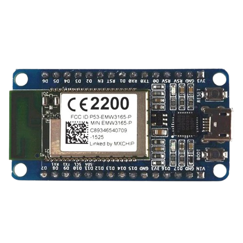

# WiFiMCU (Community Edition v1.0)

<p align="center">
  <a href="#english">🇬🇧 English</a> &nbsp;|&nbsp; <a href="#türkçe">🇹🇷 Türkçe</a>
</p>

---

<a id="english"></a>

WiFiMCU is an open-source Lua-based firmware designed for the **EMW3165 / EMW3165-P** Wi-Fi module, powered by an **STM32F411CE (ARM Cortex-M4 @ 100MHz with hardware FPU)** and a **Broadcom BCM43362** 802.11 b/g/n Wi-Fi chip.

This repository is an actively maintained fork of the original [SmartArduino/WiFiMCU](https://github.com/SmartArduino/WiFiMCU) project from 2015. It fixes critical legacy bugs (crashes, memory leaks) and adds modern IoT capabilities like native JSON parsing, network time sync, and an official high-speed CLI tool.

```text
  ;   .  . .___ .  . __ .  .      ,--.
 ["]  |  |o[__ o|\/|/  `|  | ,<-|__oo|
/[_]\ |/\|||   ||  |\__.|__| /  |//  |
 ] [                            /o|__|  [WiFiMCU Community Edition v1.0 by @bora-py]
```

<p align="center">
  
</p>

### Key Improvements in v1.0
- **`cjson` Module:** Embedded JSON encoder and decoder (`cjson.encode()`, `cjson.decode()`) implemented in C. No need for slow, memory-heavy string pattern matching.
- **`sntp` Module:** Queries NTP servers over UDP and syncs both the software clock and the STM32 hardware RTC (`sntp.sync()`, `sntp.time()`, `sntp.setoffset()`). Pre-configured with UTC+3 (Turkey Time / TRT) by default.
- **Official Lua & Bytecode CLI (`tools/wmcutool.py`):** High-speed serial uploader with strict prompt handshaking and on-device bytecode (`.lc`) compilation, eliminating UART corruption and `not enough memory` errors.
- **Fixed MQTT Hard Fault:** Eliminated uninitialized heap memory crash inside `lmqtt_new` by enforcing clean zero-allocation and safe SSL defaults.
- **Fixed MQTT Memory Leak:** Fixed socket buffer memory leaks on reconnect via `MQTTClientDeinit`.
- **Safe RTOS Thread Teardown:** FreeRTOS tasks now clean up and terminate gracefully when an MQTT connection drops.
- **Fixed GPIO Pull-Up Bug:** Fixed `gpio.INPUT_PULL_UP` being mistakenly mapped to pull-down mode.
- **Toolchain Cleanups:** Fixed non-ASCII characters in `net.c` that caused build errors on modern IAR compilers.

### Hardware Specifications (EMW3165)
- **MCU:** STM32F411CE (ARM Cortex-M4, 100MHz, FPU)
- **RAM:** 128 KB SRAM
- **Flash:** 512 KB Internal Flash + 2 MB SPI Flash
- **Wi-Fi:** Broadcom BCM43362 (802.11 b/g/n)
- **Peripherals:** 18 GPIOs, 11 PWMs, 5 ADCs, 2 UARTs, 1 I2C, 1 SPI, Hardware RTC

### Quick Code Examples

#### JSON (`cjson`)
```lua
-- Encode Lua table to JSON string
local json_str = cjson.encode({ temp = 24.5, humidity = 45, relay = true })
print(json_str)

-- Decode JSON string to Lua table
local data = cjson.decode('{"status":"ok","uptime":120}')
print("Status:", data.status)
```

#### Network Time (`sntp`)
```lua
-- Set timezone (e.g. UTC+3)
sntp.setoffset(3)

-- Sync with NTP server
sntp.sync("pool.ntp.org", function(epoch)
    print("Time synchronized! Timestamp:", epoch)
end)

-- Read current epoch
print("Current time:", sntp.time())
```

#### MQTT Client (`mqtt`)
```lua
local m = mqtt.new("wifimcu_client", 60, "", "")

mqtt.on(m, "connect", function()
    print("Connected to broker!")
    mqtt.subscribe(m, "home/room/cmd", 0)
end)

mqtt.on(m, "message", function(topic, payload)
    print("Received:", topic, payload)
    local cmd = cjson.decode(payload)
    if cmd.led == true then
        gpio.write(6, gpio.HIGH)
    end
end)

mqtt.start(m, "192.168.1.50", 1883)
```

### Flashing Firmware (C Binary)
1. Hold **BOOT**, press and release **RESET** to enter Bootloader mode.
2. Flash the binary firmware over YModem:
   ```bash
   python tools/flash_firmware.py COM3
   ```
3. Type `6` and press Enter to boot into WiFiMCU Lua runtime.

### Managing & Uploading Lua Scripts (`wmcutool.py`)
Use the included official tool `wmcutool.py` to upload scripts, compile to bytecode, and manage files on the SPIFFS flash:

```bash
# List files stored in SPIFFS flash
python tools/wmcutool.py --port COM3 ls

# Upload and compile script to bytecode (.lc) to minimize RAM usage
python tools/wmcutool.py --port COM3 upload app.lua --compile

# Reboot the board remotely
python tools/wmcutool.py --port COM3 reboot

# Format the SPIFFS filesystem
python tools/wmcutool.py --port COM3 format
```
> **Tip:** Compiling scripts to `.lc` with `--compile` bypasses the Lua parser in RAM during boot, dramatically reducing heap consumption and eliminating `not enough memory` crashes on large scripts.

### License & Acknowledgments
- Original project: [SmartArduino / MXCHIP (2015)](https://github.com/SmartArduino/WiFiMCU)
- Community Edition: [@bora-py](https://github.com/bora-py) (2026)
- Released under the MIT License.

---

<a id="türkçe"></a>

WiFiMCU, **EMW3165 / EMW3165-P** modülü için geliştirilmiş açık kaynaklı bir Lua yazılımıdır. Kartın üzerinde **100MHz hızında çalışan donanımsal FPU destekli STM32F411CE ARM Cortex-M4** mikrodenetleyici ve **Broadcom BCM43362** Wi-Fi çipi bulunur.

Bu depo, 2015 yılından kalma orijinal [SmartArduino/WiFiMCU](https://github.com/SmartArduino/WiFiMCU) projesinin gönüllü olarak güncellenen topluluk sürümüdür. Eski sürümdeki çökme ve bellek sızıntısı hataları giderilmiş, modern IoT projeleri için yerel JSON desteği, NTP saat senkronizasyonu ve resmi komut satırı yükleme aracı eklenmiştir.

### v1.0 ile Gelen Yenilikler
- **`cjson` Modülü:** C seviyesinde yazılmış gömülü JSON kodlayıcı ve çözücü (`cjson.encode()`, `cjson.decode()`). Artık REST API ve MQTT mesajları için RAM harcayan karmaşık metin arama işlemlerine gerek yok.
- **`sntp` Ağ Saati Modülü:** NTP sunucularından UDP ile saat bilgisini çekip STM32'nin donanımsal RTC saatiyle senkronize eder (`sntp.sync()`, `sntp.time()`, `sntp.setoffset()`). Varsayılan olarak UTC+3 (Türkiye Saati / TSI) ayarlıdır.
- **Resmi Lua & Bytecode CLI Aracı (`tools/wmcutool.py`):** Katı el sıkışmalı (handshake) ve cihaz üstü bytecode (`.lc`) derleme destekli yükleme aracı. UART taşmalarını ve `not enough memory` bellek yetersizliği hatalarını tamamen çözer.
- **MQTT Hard Fault Çözümü:** `lmqtt_new` fonksiyonundaki başlatılmamış bellek nedeniyle oluşan Cortex-M4 çökmeleri temiz `memset` ve güvenli işaretçi kontrolleriyle giderildi.
- **MQTT Bellek Sızıntısı Giderildi:** Bağlantı kopup yeniden bağlandığında soket tamponlarının RAM'de kalması `MQTTClientDeinit` ile çözüldü.
- **Temiz RTOS Görev Sonlandırma:** Wi-Fi koptuğunda askıda kalan FreeRTOS görevleri düzgünce temizlenip kapatılıyor.
- **GPIO Pull-Up Hatası Düzeltildi:** `gpio.INPUT_PULL_UP` modunun yanlışlıkla pull-down olarak kaydedilme hatası düzeltildi.
- **Derleyici Uyumluluğu:** `net.c` içindeki eski ASCII dışı karakterler temizlenerek modern IAR derleyicilerine tam uyumlu hale getirildi.

### Donanım Özellikleri (EMW3165)
- **İşlemci:** STM32F411CE (ARM Cortex-M4, 100MHz, FPU)
- **RAM:** 128 KB SRAM
- **Flaş:** 512 KB Dahili + 2 MB Harici SPI Flash
- **Wi-Fi:** Broadcom BCM43362 (802.11 b/g/n)
- **Giriş/Çıkış:** 18 GPIO, 11 PWM, 5 ADC, 2 UART, 1 I2C, 1 SPI, Dahili RTC

### Hızlı Kod Örnekleri

#### JSON Kullanımı (`cjson`)
```lua
-- Lua tablosunu JSON metnine çevirme
local json_metin = cjson.encode({ sicaklik = 24.5, nem = 45, role = true })
print(json_metin)

-- JSON metnini Lua tablosuna çevirme
local veri = cjson.decode('{"durum":"tamam","uptime":120}')
print("Durum:", veri.durum)
```

#### Ağ Saati (`sntp`)
```lua
-- Türkiye için saat dilimi (UTC+3)
sntp.setoffset(3)

-- NTP sunucusu ile saati eşitle
sntp.sync("pool.ntp.org", function(epoch)
    print("Saat eşitlendi! Zaman damgası:", epoch)
end)

-- Güncel zamanı saniye cinsinden al
print("Şu anki zaman:", sntp.time())
```

#### MQTT Kullanımı (`mqtt`)
```lua
local m = mqtt.new("oda_istasyonu", 60, "", "")

mqtt.on(m, "connect", function()
    print("Broker'a bağlandı!")
    mqtt.subscribe(m, "ev/oda/komut", 0)
end)

mqtt.on(m, "message", function(konu, mesaj)
    print("Gelen komut:", konu, mesaj)
    local komut = cjson.decode(mesaj)
    if cmd.led == true then
        gpio.write(6, gpio.HIGH)
    end
end)

mqtt.start(m, "192.168.1.50", 1883)
```

### Firmware Nasıl Yüklenir? (C Binary)
1. Kartın üzerindeki **BOOT** butonuna basılı tutun, ardından **RESET** butonuna basıp bırakın (Bootloader moduna geçer).
2. Python yükleme aracını çalıştırın:
   ```bash
   python tools/flash_firmware.py COM3
   ```
3. İşlem bitince `6` yazıp Enter'a basarak Lua ortamını başlatın.

### Lua Dosyalarını Yükleme ve Yönetme (`wmcutool.py`)
Geliştirdiğiniz Lua betiklerini karta aktarmak, SPIFFS belleği yönetmek ve kodları bytecode (`.lc`) formatına derlemek için resmi `wmcutool.py` aracını kullanabilirsiniz:

```bash
# Kartın SPIFFS belleğindeki dosyaları listeleme
python tools/wmcutool.py --port COM3 ls

# Dosyayı yükleyip RAM tasarrufu için bytecode (.lc) olarak derleme
python tools/wmcutool.py --port COM3 upload app.lua --compile

# Kartı uzaktan yeniden başlatma (reboot)
python tools/wmcutool.py --port COM3 reboot

# SPIFFS dosya sistemini sıfırlama (format)
python tools/wmcutool.py --port COM3 format
```
> **İpucu:** Dosyalarınızı `--compile` parametresiyle yüklediğinizde kod kartın üzerinde `.lc` (bytecode) formatına dönüştürülür. Bu sayede açılışta Lua derleyicisi RAM harcamaz ve `not enough memory` bellek yetersizliği hatası yaşanmaz.

### Lisans & Teşekkür
- Orijinal proje: [SmartArduino / MXCHIP (2015)](https://github.com/SmartArduino/WiFiMCU)
- Topluluk Sürümü: [@bora-py](https://github.com/bora-py) (2026)
- MIT Lisansı altında sunulmaktadır.
